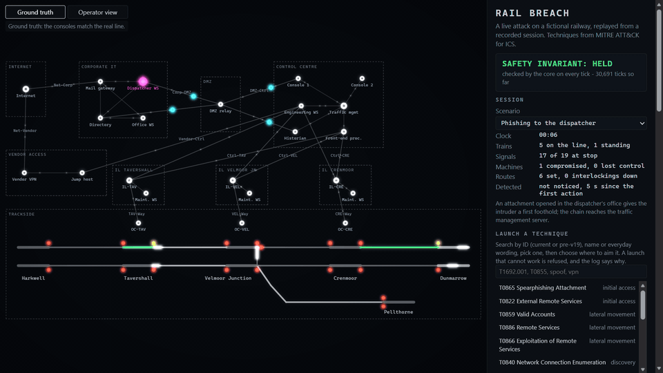
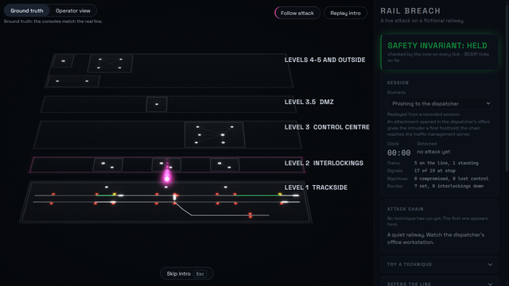
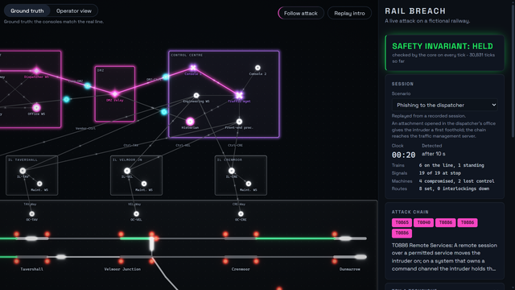
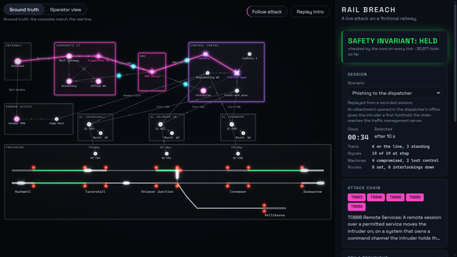
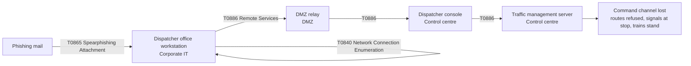

# Rail Breach

[](https://github.com/oliver-dolski/rail-breach/actions/workflows/deploy.yml)
[](LICENSE)

Watch an ATT&CK for ICS attack spread across a fictional railway, then stop it with segmentation.

Live demo: <https://oliver-dolski.github.io/rail-breach/> (no key, no install).



The phishing scenario from the intro to the first halted train (00:34), at 2x real speed. Recorded from the app by npm run media:capture.

<p>  </p>

Rail Breach is a live, deterministic simulation of an attack on a fictional
mainline railway, built from MITRE ATT&CK for ICS v19.2 techniques. It runs in
the browser with no backend. A rule engine moves the intruder from machine to
machine across an invented network of corporate IT, a vendor link, a DMZ, a
control centre, three interlockings and the trackside equipment. The railway
answers the way a fail-safe interlocking does: signals go to stop, routes are
refused, trains stand. You can also place defenses and watch the same attack
stop at a zone boundary.

## What you see

A schematic dispatcher map on a dark ground, with the side panel to its right.

- **Network zones and conduits.** Translucent panels with a lit edge are zones
  (Corporate IT, DMZ, Control centre, one per interlocking, Trackside, and the
  untrusted Internet and vendor access). A panel takes the attacker's colour
  while the intruder holds a machine in it, and the colour of an impact once a
  machine in it has lost control. The thick lines between zones are conduits, in
  the sense of IEC 62443.
- **Machines.** A ring is a normal machine. A diamond means the intruder holds
  it. A triangle is degraded. A cross is a machine whose operators lost control.
  Colour is never the only cue: each state has its own shape.
- **Particles.** Each glowing dot is a packet. The intruder's traffic is
  magenta and travels along the real links of the topology, at the link's
  latency.
- **The trail.** Every link the intruder's traffic has crossed stays lit in
  magenta until the session restarts, so the whole chain of the attack can be
  read in a single frame. A link that is crossed again lights up once more.
- **The railway.** Stations on the main line, a branch, lineside signals
  (red for stop, amber for caution, green for proceed) and trains that
  accelerate and brake with real distances.
- **Safety invariant indicator.** The panel states whether the safety rules of
  the interlocking hold, checked every tick. It reads HELD for the whole show.
- **Ground truth and operator view.** A switch shows either what is happening or
  what the control room can see. An attacker who spoofs the reports gives the
  operators a false all-clear; one who freezes them gives the last good picture.
- **Event log, refusals and IDS alerts.** Every launch, every operation, every
  route the interlocking refuses and every sensor alert is written down in words.
- **Two-lane timeline.** Attacker and detection on one axis. The shaded gap is
  the time the intruder went unnoticed.
- **Camera.** The map leans in on the zone where the attack is happening and
  pulls back to the whole board once a train stands. Follow attack, a button over
  the map, switches it off, and so does turning the wheel or dragging the map. With
  reduced motion the camera stays on the whole board.
- **Intro.** The first load opens with four seconds in which the five Purdue
  levels of the network hang apart as layers and fold into the map. Escape, a
  click or the Skip intro pill skips it, and Replay intro plays it again. It is
  not played with reduced motion or on a very small stage.

After the intro, the phishing scenario runs on a timeline you can check against
the clock in the panel: the first IDS alert at 00:11, the signals of the routes
not yet entered at stop at 00:18, the first train brought to a stand at 00:32.
The clock starts when the intro ends, so these times hold whether the intro is
watched or skipped. A train needs about half a minute to stop from line speed at
the service braking rate, so that is the floor.

## Scenarios

| Scenario | Starts at | Technique chain | On the tracks |
| --- | --- | --- | --- |
| Phishing to the dispatcher | The dispatcher office workstation in Corporate IT | T0865 Spearphishing Attachment, T0840 Network Connection Enumeration, then T0886 Remote Services three times: DMZ relay, dispatcher console, traffic management server | The operators lose their command channel. Routes are refused, signals of routes not yet entered drop to stop, trains stand. Lands about 18 s in. |
| Vendor VPN | The vendor VPN gateway | T0822 External Remote Services, T0840, T0886 to the vendor jump host and to the control centre engineering workstation, then T0880 Loss of Safety at the Tavershall interlocking | The path bypasses the DMZ. The interlocking loses its safety function, its signals go dark and a train on the approach stands. Lands about 23 s in. |
| Insider in the signal box | The maintenance workstation in the Velmoor Junction signal box (assumed breach, no way in is shown) | T0840, T0859 Valid Accounts, T0836 Modify Parameter, then T0880 at the Velmoor Junction interlocking | Trains first crawl under a lowered speed limit, then the signals go dark and they stand. Lands about 21 s in. |

The scenario picker is at the top of the panel. Each scenario has a fixed seed,
chosen so that every random roll in its chain goes the attacker's way, and a
test pins the story.

The phishing chain, machine by machine:



## Try your own

- **Picker.** Search the techniques by ID (the current one or the one from
  before v19), by name or by everyday words ("vpn", "spoof"), pick one and
  choose where to aim it. A launch that cannot work is refused, and the log
  says why.
- **Free text, offline.** Type "phishing to the dispatcher" or "scan the
  network" and press Interpret. A keyword matcher in the browser turns it into
  technique steps and shows them as chips marked "interpreted as". Nothing runs
  until you press Run.
- **Own-key mode (optional).** If you paste an Anthropic API key, Interpret
  sends the text and the closed list of technique IDs to the Messages API
  (`api.anthropic.com`) from your browser, with `claude-sonnet-5-5` by default
  and `claude-opus-5-5` selectable. The key lives in `sessionStorage` of the tab,
  is never recorded and never shown again, and the page's Content Security
  Policy allows connections to that one host only. The reply is a forced tool
  call over the closed list of techniques; anything outside it discards the
  whole reply, and any failure falls back to the offline matcher. The engine
  never receives free text, only resolved technique steps.

## Defend the line

Pick a defense, then click a conduit on the map or use its button in the panel.

- **Firewall.** An allow-list on the conduit: traffic the list does not name
  stops there.
- **Data diode.** Data may pass in one direction only, to the office or to the
  tracks, as seen from the Purdue level of each zone.
- **IDS sensor.** Adds alert chances on the link it watches. A sensor only adds
  alerts and never changes what the attacker can do.

A placement comes into force after a short latency. The panel counts the time
to detect, and the compare view runs the same session twice, with and without
your defenses, and tells you which rows changed for the better or the worse. It
is a sandbox: no score.

## Fail-safe by design

The interlocking derives every signal aspect from route locking and track
occupancy and defaults to stop. What the attacks in this model can do is stop
trains, blind the operators and take control away. They do not produce a
collision or a permissive movement the interlocking did not give.

A signal that drops to stop in front of a train that is already too close to
stop at it cannot be obeyed. The train runs on into the overlap, the stretch of
track kept clear behind the signal for exactly this case, and stands there. The
overrun is flagged, and it is contained by the overlap: the overlap is
validated against the emergency braking distance. The safety invariant is
asserted on every tick of the simulation and fuzzed across all techniques in
the test suite.

This is a deliberate simplification of a mainline interlocking with lineside
signals, not a safety case. It has no CBTC (that is a metro system) and says
nothing about ETCS beyond the general idea.

## ATT&CK for ICS v19.2

The technique catalogue is generated by `scripts/build-attack.mjs` from the
pinned STIX bundle of ATT&CK for ICS v19.2 (the SHA-256 is checked before
anything is parsed), never typed by hand. The table below is generated from
that catalogue by `npm run readme:techniques`, and a test fails when it drifts.

<!-- techniques:start -->
ATT&CK for ICS 19.2, 13 techniques. Generated by `npm run readme:techniques` from `src/content/attack-ics.json` (source bundle SHA-256 `08b83d2cea6b6d6752468ef0e62e2ab2a53c9443ef72c439ecccb07ab9e89da9`). Do not edit by hand.

| ID | Name | Tactics | Before v19 |
| --- | --- | --- | --- |
| [T0813](https://attack.mitre.org/techniques/T0813/) | Denial of Control | Impact |  |
| [T0822](https://attack.mitre.org/techniques/T0822/) | External Remote Services | Initial Access |  |
| [T0829](https://attack.mitre.org/techniques/T0829/) | Loss of View | Impact |  |
| [T0836](https://attack.mitre.org/techniques/T0836/) | Modify Parameter | Impair Process Control |  |
| [T0840](https://attack.mitre.org/techniques/T0840/) | Network Connection Enumeration | Discovery |  |
| [T0859](https://attack.mitre.org/techniques/T0859/) | Valid Accounts | Persistence, Lateral Movement |  |
| [T0865](https://attack.mitre.org/techniques/T0865/) | Spearphishing Attachment | Initial Access |  |
| [T0866](https://attack.mitre.org/techniques/T0866/) | Exploitation of Remote Services | Initial Access, Lateral Movement |  |
| [T0880](https://attack.mitre.org/techniques/T0880/) | Loss of Safety | Impact |  |
| [T0886](https://attack.mitre.org/techniques/T0886/) | Remote Services | Initial Access, Lateral Movement |  |
| [T1691.001](https://attack.mitre.org/techniques/T1691/001/) | Block Operational Technology Message: Command Message | Inhibit Response Function | T0803 |
| [T1692.001](https://attack.mitre.org/techniques/T1692/001/) | Unauthorized Message: Command Message | Evasion, Impair Process Control | T0855 |
| [T1692.002](https://attack.mitre.org/techniques/T1692/002/) | Unauthorized Message: Reporting Message | Evasion, Impair Process Control | T0856 |
<!-- techniques:end -->

Three IDs that earlier versions of ATT&CK for ICS used were revoked in v19 and
now resolve to their successors:

- T0855 is now T1692.001
- T0803 is now T1691.001
- T0856 is now T1692.002

The app shows both IDs and its search accepts either. A test fails the build if
any file, this README included, names an ID that is not in the catalogue or is
revoked without being a known alias.

## How it works

- **Ticks.** The simulation advances in integer ticks of 100 ms. The core reads
  no wall clock and no host randomness, and a lint rule enforces it.
- **Seeded randomness.** A seeded, stateless PRNG: the same seed gives the same
  rolls, in any order.
- **Recorded sessions.** A session is a seed plus a list of actions, with hash
  checkpoints. The tests replay each recording and compare the hashes byte for
  byte, so a change in the engine cannot silently change the story.
- **A core without a DOM.** The engine, the rail model and the detection model
  have no browser dependency, and a lint rule keeps it that way.
- **Rendering.** WebGL2 through a small helper library, with a plain DOM panel
  and no framework.
- **Media.** The GIF above is captured from the production build with a manual
  frame clock, so every frame is identical on every run.

## Run it locally

Node 22.12 or newer (CI runs 24). The project has one runtime dependency.

```text
npm ci
npm run dev                  # the app, at the address Vite prints
npm test                     # the full test suite
npm run typecheck            # also: typecheck:core
npm run lint                 # also: lint:core
npm run build                # production build into dist/
npm run smoke                # serves dist/ the way Pages does and drives a fresh browser
npm run scan:history         # hygiene scan of the whole git history
npm run media:capture        # rebuilds the GIF, stills and cards (Windows, Edge, ffmpeg)
```

`npm run readme:techniques` rewrites the generated table above, and
`npm run check:links` checks the links of this file.

## Scope and disclaimer

Every station, line, device, address and name in Rail Breach is invented. There is
no real operator, no real infrastructure and no real procedure behind it, and no
operator data was used. The network is a teaching topology with deliberately
weak spots so that the attacks have something to show.

Techniques are shown at the level of MITRE ATT&CK for ICS: what an adversary
tries to achieve, not how. There is no exploit code, no CVE and no command to
run against a real system. The interlocking is simplified and is not a safety
case.

The mechanic of typing an input and watching its effect spread was inspired by
[jev-alchemy](https://github.com/Wachu2005/jev-alchemy). No code is shared.

## License

Apache-2.0, see [LICENSE](LICENSE). Third-party notices, including the MITRE
designation and the bundled twgl.js, are in [NOTICE](NOTICE).

Technique identifiers, names and tactics come from MITRE ATT&CK® for ICS
v19.2. © 2026 The MITRE Corporation. This work is reproduced and distributed
with the permission of The MITRE Corporation. MITRE ATT&CK and ATT&CK are
registered trademarks of The MITRE Corporation, see the
[Terms of Use](https://attack.mitre.org/resources/legal-and-branding/terms-of-use/).
Rail Breach is an independent project and is not affiliated with The MITRE Corporation.
